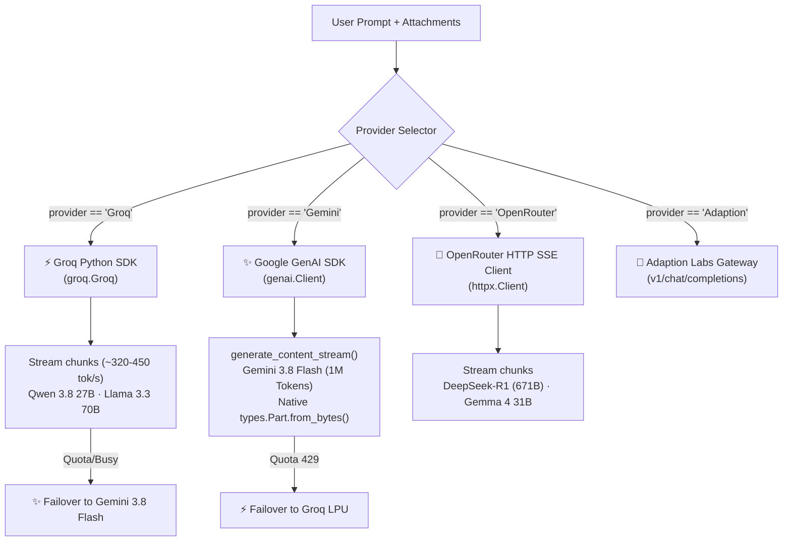

# 🌌 AI Hub Architecture & Engineering Specification

> **Purpose**: Modular engineering documentation covering the UI design system, frontend client interaction, backend inference engine, and data flow. Structured so each section can be provided individually to external AI systems (such as Claude) to audit, diagnose, and provide precise fix prompts.

---

# 🎨 PART 1: UI & VISUAL DESIGN SYSTEM

### 1.1 Core Files & Styling Hierarchy
* **`src/studio_theme.css`**: Primary theme stylesheet (~1,200 lines). Contains CSS variables, dynamic animatable properties, aurora mesh shaders, cursor spotlight, custom scrollbars, and Streamlit element overrides.
* **`ui_kit.py` (`CSS` variable)**: Localized component styling (~250 lines). Houses the floating glass nav bar, sticky prompt dock, model selector popover, and chat message bubble styles.
* **`app.py` (`STUDIO_CSS` variable)**: Global base resets, typography definitions, and selectbox caret suppression.

### 1.2 Design Tokens & Color Palette
```css
:root {
  /* Canvas & Panel Colors */
  --ink: #07080d;          /* Ultra-deep space canvas */
  --panel: #0e1018;        /* Base container dark glass */
  --panel-elev: #141722;   /* Elevated cards & popovers */
  --border-subtle: rgba(255, 255, 255, 0.08);
  --border-hover: rgba(255, 255, 255, 0.18);

  /* Semantic Accent Spectrum */
  --c-indigo: #6366f1;     /* Primary brand & Tab 1 (Chat) */
  --c-cyan: #22d3ee;       /* Telemetry & Tab 1 secondary */
  --c-violet: #a855f7;     /* Tab 2 (Auditor) primary */
  --c-fuchsia: #ec4899;    /* Tab 2 (Auditor) & Tab 3 secondary */
  --c-amber: #fbbf24;      /* Tab 3 (Media) secondary */
  --c-mint: #34d399;       /* Tab 4 (Deployment) primary */

  /* Typography */
  --display: 'Space Grotesk', -apple-system, sans-serif;
  --font: 'Inter', -apple-system, sans-serif;
  --mono: 'JetBrains Mono', monospace;
}
```

### 1.3 The Atmospheric Aurora Shader Engine
* **Animatable CSS Properties**:
  ```css
  @property --a1 { syntax: '<color>'; inherits: true; initial-value: #6366f1; }
  @property --a2 { syntax: '<color>'; inherits: true; initial-value: #22d3ee; }
  ```
* **Tab-Reactive Color Transitions**:
  When tabs switch, JavaScript or Streamlit sets `html[data-tab="N"]`:
  * `data-tab="0"` (Chat): Indigo `#6366f1` → Cyan `#22d3ee`
  * `data-tab="1"` (Auditor): Violet `#a855f7` → Fuchsia `#ec4899`
  * `data-tab="2"` (Media Studio): Fuchsia `#ec4899` → Amber `#fbbf24`
  * `data-tab="3"` (Deployment): Emerald `#34d399` → Cyan `#22d3ee`
* **Vortex & Spotlight Layers**:
  * `.stApp::before`: Fixed multi-radial gradient vortex rotating on a 24-second infinite alternate keyframe cycle (`transform: translate3d(...) rotate(...)`).
  * `.stApp::after`: Fixed cursor-following radial spotlight bound to CSS custom properties `--mx` and `--my` updated by mouse movements.

### 1.4 Critical Layout Overrides & Stacking Contexts
1. **Header Transparency & Non-Blocking Pointer Events**:
   * `header[data-testid="stHeader"]` and `[data-testid="stToolbar"]` use `pointer-events: none !important; background: transparent !important; border: none !important;`.
   * Only interactive descendants (`[data-testid="stToolbarActions"]`, `[data-testid="stMainMenuButton"]`) have `pointer-events: auto !important;`. This ensures clicks pass through to page elements below the header.
2. **Left Sidebar Collapse / Expand Mechanism**:
   * `section[data-testid="stSidebar"]`: Elevated to `z-index: 9999 !important;`.
   * `[data-testid="stSidebarCollapseButton"]`: Pinned at top right of the sidebar (`z-index: 10002 !important; pointer-events: auto !important;`).
   * `[data-testid="stExpandSidebarButton"]`: Styled as a frosted glass pill at `top: 1rem; left: 1rem; z-index: 10002 !important;` so users can expand the sidebar with 1 click when collapsed.
3. **Floating Translucent Navigation Bar**:
   * Container `.st-key-nav_wrapper` uses `position: sticky; top: 3.75rem; z-index: 990;`.
   * Radio options styled as frosted pills (`rgba(14, 18, 28, 0.45)` with `backdrop-filter: blur(16px) saturate(160%)`). All native radio circles are hidden via `display: none !important;`.

---

# 💻 PART 2: FRONTEND INTERACTION & CLIENT ARCHITECTURE

### 2.1 Core Files & Responsibilities
* **`ui_kit.py`**: The bridge between Streamlit's Python runtime and client HTML/CSS. Replaces native `st.tabs` with a persistent sticky navigation bar, mounts the sticky prompt dock, and controls model popovers.
* **`src/studio_fx.js`**: Pure vanilla JavaScript injected into the top-level window via `streamlit.components.v1.html`. Manages cursor physics, magnetic buttons, scroll tracking, and the floating jump-to-bottom button.
* **`src/studio_components.py`**: Pure HTML string builders generating cyberpunk mecha badges, animated hero banners, health telemetry tiles, and media preview cards.

### 2.2 Client-Side Interactive Motion Engine (`studio_fx.js`)
* **Spring Cursor Physics**:
  * Creates two DOM nodes: `.fx-cursor-dot` (leads the pointer directly) and `.fx-cursor-ring` (trails with an elastic lerp factor: `rx += (mx - rx) * 0.22`).
  * Transforms into `is-text` (vertical bar) over inputs and `is-link` (scaled ring) over buttons/dropdowns.
* **Magnetic Button Pull**:
  * Calculates vector distance between pointer `(mx, my)` and button centers. Translates buttons up to ±6px horizontally and ±4px vertically on hover.
* **Floating Jump-to-Bottom Button (`#fx-scroll-bottom-btn`)**:
  * Monitors scroll offset of `[data-testid="stMain"]`. When the user scrolls upward by >250px from bottom, the button fades in (`opacity: 1; visibility: visible;`).
  * On click, smoothly scrolls `stMain` to `scrollHeight` and automatically transfers keyboard focus to `stChatInputTextArea`.
* **Caret Suppression**:
  * Dynamically prevents blinking vertical carets inside read-only dropdown selectboxes.

### 2.3 Navigation & Chat Dock Integration
* **Why `st.tabs` Was Replaced**:
  Streamlit only pins `st.chat_input` to the bottom of the screen when it is rendered at the page root. When placed inside `with tab1:`, Streamlit floats the chat input inline below the chat messages.
* **The Solution**:
  ```python
  # ui_kit.py
  view = ui.nav()  # Renders sticky radio group and reads active tab

  if view == NAV[0]:
      ui.render_chat(generate)  # Prompt dock rendered at page root!
  elif view == NAV[1]:
      render_auditor()
  elif view == NAV[2]:
      render_media_studio()
  elif view == NAV[3]:
      render_deploy_guide()
  ```

### 2.4 Prompt Dock & Attachment Pipeline
* **Sticky Toolbar**: Located directly above the prompt input (`.st-key-dock_toolbar`), housing the popover model selector.
* **Attachment Parser**: Supports multi-file uploads (`accept_file="multiple"`):
  * **Images (`.png`, `.jpg`, `.jpeg`, `.webp`)**: Decoded as raw bytes and attached to message history for Gemini Vision.
  * **PDFs (`.pdf`)**: Extracted page-by-page via `pypdf`/`pdfplumber` and injected as context.
  * **Code & Notes (`.py`, `.js`, `.ts`, `.md`, `.json`, `.csv`, `.txt`)**: Formatted as syntax-highlighted markdown file attachments (`--- ATTACHED FILE: {name} ---`).

---

# ⚙️ PART 3: BACKEND ARCHITECTURE & INFERENCE PIPELINES

### 3.1 Multi-Provider Inference Engine (`generate()` in `app.py`)
`generate(model, messages, attachments)` implements unified streaming across 4 distinct backends:



### 3.2 Vision & Multimodal Image Identification
* **Model Endpoint**: `gemini-3.8-flash` (with fallback to `gemini-2.5-flash-lite`).
* **Image Ingestion**:
  ```python
  # Binary payload directly converted to SDK types.Part
  contents.append(types.Part.from_bytes(data=att["data"], mime_type=mime))
  ```
* **Auto-Routing Rule**: If a user uploads an image while a text-only model (e.g. Groq Qwen) is active, `generate()` detects `has_image_attachment` and automatically redirects the turn to `gemini-3.8-flash`.

### 3.3 Generative Media Synthesizers
1. **High-Resolution Vector / Image Generation**:
   * Uses Cloud FLUX.1 via Pollinations API (`image.pollinations.ai/prompt/...`) for zero-card 1024×1024 rendering.
   * If Google Colab Bridge is connected, routes to `POST /generate_image` on the Colab T4 GPU running `stabilityai/sdxl-turbo`.
2. **Harmonic 44.1kHz Stereo Soundtrack Engine**:
   * `generate_cinematic_soundtrack(prompt, duration_sec)`:
   * Pure procedural Python/NumPy synthesizer running at **0% GPU load**.
   * Classifies mood keywords (`romantic`, `gaming`, `cyberpunk`, `space`, `edm`, `trap`, `lo-fi`).
   * Synthesizes 4-layer polyphonic audio: (1) soft-envelope sub-bass, (2) rich detuned stereo pads, (3) gentle percussive transients, and (4) acoustic melodic leads.
   * Compiles into standard 16-bit stereo WAV PCM bytes.
3. **Multi-Scene Video Engine**:
   * `synthesize_multiscene_video(prompt)`: Generates keyframes with progressive prompt shifts and interpolates cosine transition dissolves at 24 FPS.

### 3.4 Google Colab 16GB T4 GPU Bridge (`colab_bridge_server.py`)
* Dedicated FastAPI microservice running inside Google Colab.
* Exposes:
  * `GET /health`: GPU memory telemetry, VRAM usage, active pipeline status.
  * `POST /generate_image`: Diffusers SDXL Turbo / SD 1.5 pipeline.
  * `POST /generate_video`: Video diffusion pipeline (`damo-vilab/text-to-video-ms-1.7b`).
* Memory Management:
  * Uses `PYTORCH_CUDA_ALLOC_CONF="expandable_segments:True"`.
  * Dynamic pipeline swapper: completely unloads and clears VRAM (`gc.collect()` + `torch.cuda.empty_cache()`) when switching between image and video pipelines to prevent OOM errors on the 16GB T4 GPU.

### 3.5 Universal GitHub Cloud Deployer (Tab 4)
* **Auto-Updater**:
  * `get_user_github_repos(account)`: Fetches public repositories from `https://api.github.com/users/{account}/repos?per_page=100`.
* **Tree Inspector**:
  * `get_repo_python_files(account, repo, branch)`: Recursively queries `/repos/{account}/{repo}/git/trees/{branch}?recursive=1`.
  * Filters out virtual environments and tests. Automatically surfaces actual application entrypoints (e.g. `backend/main.py` for `NiveshRakshak`).
* **Deployment URL Formatter**:
  ```text
  https://share.streamlit.io/deploy?repository={owner}/{repo}&branch={branch}&mainModule={file_path}
  ```

### 3.6 Model Context Protocol (MCP) Integration (`mcp_server.py`)
Exposes studio tools directly to agentic environments:
* `generate_cloud_image(prompt, width, height, model)`
* `generate_anime_logo(prompt, style)`
* `generate_animation_video(prompt, duration_sec)`
* `audit_multimodal_documents(file_paths, objective)`
* `groq_fast_query(prompt, model)`
* `call_adaption_adapter(prompt, adapter_id)`
* `get_live_deployment_status()`

---

# 🔄 PART 4: DATA FLOW & END-TO-END LIFECYCLE

```mermaid
sequenceDiagram
    autonumber
    actor User
    participant Browser as Browser Client (studio_fx.js)
    participant UI as UI Kit & Navigation (ui_kit.py)
    participant App as Studio Orchestrator (app.py)
    participant Cloud as Cloud AI Backends (Groq / Gemini / Colab)

    User->>Browser: Types prompt & attaches image
    Browser->>UI: Submit via st.chat_input
    UI->>App: Invokes generate(model, messages, attachments)
    
    alt Visual Attachment Present
        App->>Cloud: Routes to Gemini 3.8 Flash with types.Part.from_bytes()
    else Fast Text Query
        App->>Cloud: Routes to Groq LPU (Qwen 3.8 27B / Llama 3.3 70B)
    else Generative Intent (Image / Logo / Audio)
        App->>Cloud: Calls FLUX Cloud / Procedural Audio Synthesizer
    end

    Cloud-->>App: Streams token deltas or media bytes
    App-->>UI: Yields streaming markdown or sets session media
    UI-->>Browser: Renders chat bubble, media card, or syntax-highlighted code
    Browser->>User: Displays response; spring cursor & jump button update
```
