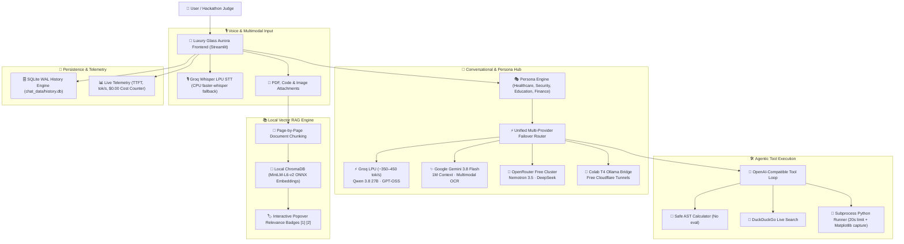

<div align="center">

# ⚡ AI HUB — Autonomous Multi-Model Prototyping Studio
### *Zero-GPU Hackathon Studio for Real-Time LLM Streaming, Multilingual Neural Voice, Local ChromaDB Vector RAG & Agentic Subprocess Execution*

[](https://share.streamlit.io/)
[](https://python.org)
[](LICENSE)
[-34d399.svg?style=for-the-badge)](https://github.com/ankush-dev-eng/ai-hub)
[](https://github.com/ankush-dev-eng/ai-hub)

<br/>

```
  █████╗ ██╗    ██╗  ██╗██╗   ██╗██████╗ 
 ██╔══██╗██║    ██║  ██║██║   ██║██╔══██╗
 ███████║██║    ███████║██║   ██║██████╔╝
 ██╔══██║██║    ██╔══██║██║   ██║██╔══██╗
 ██║  ██║██║    ██║  ██║╚██████╔╝██████╔╝
 ╚═╝  ╚═╝╚═╝    ╚═╝  ╚═╝ ╚═════╝ ╚═════╝ 
   Autonomous Multi-Model Prototyping Platform
```

<p align="center">
  <b>450+ tok/s Unified LPU Hub</b> • 
  <b>Multilingual Sentence-Streaming Voice</b> • 
  <b>Local ChromaDB Vector RAG with Popover Badges</b> • 
  <b>Judge & Demo Presentation Mode</b>
</p>

</div>

---

## 🌌 Overview

**AI Hub** is an elite multi-model AI workspace designed for rapid hackathon prototyping, live technical demonstrations, and production MVPs. It unifies the fastest free-tier cloud inference engines, real-time sentence-level neural voice synthesis, local vector embeddings, and sandboxed code execution into a luxury translucent glass UI running at **0% local GPU load** and **$0.00 lifetime cost**.

---

## 🏛️ System Architecture



---

## 🌟 Flagship Features

### 1. ⚡ 450+ tok/s Multi-Provider Failover Engine
- Speaks universal OpenAI wire format across **Groq LPU**, **Google Gemini Flash**, **OpenRouter**, and **custom Colab T4 Ollama tunnels** (`endpoints.json`).
- **Zero-Downtime Auto-Failover**: If the primary provider hits rate limits or network issues, the request instantly cascades to secondary providers without user disruption.
- **Model Arena**: Side-by-side benchmark mode to evaluate two models simultaneously on the same prompt with live speed and latency telemetry.

### 2. 🎙️ Parallel Sentence-Level Streaming Neural Voice
- **Low-Latency Synthesis**: Edge-TTS workers synthesize audio clips sentence-by-sentence in parallel as tokens stream in.
- **Multilingual Support**: Real-time neural voices for Indian English (`en-IN-NeerjaNeural`, `en-IN-PrabhatNeural`), Hindi (`hi-IN-SwaraNeural`), and Marathi (`mr-IN-AarohiNeural`).
- **Devanagari Auto-Routing**: Automatic language detection ensures Hindi/Marathi text never reads phonetically garbled.
- **Parent Window Queue**: Clips play consecutively via a persistent parent queue that survives Streamlit component re-renders.
- **Instant Voice Replay**: Historical assistant messages feature an instant `🔊 Replay Voice` button.

### 3. 📚 Local ChromaDB Vector RAG with Popover Citation Badges
- **100% Offline & Free**: Local ONNX `all-MiniLM-L6-v2` embeddings run on CPU without requiring embedding API keys.
- **Page-Level PDF Extraction**: Extracts documents page-by-page and stores exact page numbers in metadata.
- **Accurate Relevance Scoring**: Automatically detects vector distance space (`l2` vs `cosine`) and computes 0%–100% relevance scores.
- **Interactive Badges**: Color-coded relevance badges (`🟢 >=50%`, `🟡 >=35%`, `🔴 <35%`) with checkmarks (`✓`) indicating which sources were cited. Clicking opens popover previews with chunk text, page number, and distance metrics.
- **Untrusted Context Guard**: Built-in prompt defense prevents prompt injection attacks from malicious uploaded files.

### 4. 🎭 Specialized Domain Persona Presets
- **🩺 Healthcare & Medical Triage Domain**: First-aid triage and rural health guidance in Marathi, Hindi & English. Strict non-diagnostic guardrails, 108/112 emergency escalation protocols.
- **🎓 Education & Technical Exam Domain**: Interactive oral viva exam quizzes, automated grading out of 10, diagnostic feedback, and dynamic difficulty scaling.
- **🛡️ Software & Cybersecurity Domain**: Defensive code auditing, vulnerability identification (CWE/OWASP), and concrete drop-in remediation patches.
- **📈 Finance & Risk Analysis Domain**: Portfolio risk analysis, mathematical valuation, and financial document inspection.
- **💬 General Purpose Domain**: Balanced everyday assistant with live web search and safe calculation.
- **Custom Persona Builder**: Sidebar expander to create, edit, and persist custom domain personas (`chat_data/personas.json`).

### 5. 🛠️ Sandboxed Agentic Tool Execution
- **Safe AST Calculator**: Mathematical expression evaluator using Abstract Syntax Trees (`ast.parse`) with exponent/memory caps—**never uses unsafe `eval()`**.
- **DuckDuckGo Web Search**: Real-time web retrieval with automatic source URL citation.
- **Isolated Python Runner**: Subprocess execution with scrubbed environment variables, 20-second timeout, memory safeguards, and automatic Matplotlib plot extraction (`out_*.png` → base64 data URIs).
- **Prompt Injection Guard**: Strict mutual exclusion prevents co-enabling web search and the Python runner to prevent indirect prompt steering.

### 6. 🚀 Judge & Demo Presentation Mode
- **Live Telemetry Strip**: Displays real-time `tok/s`, `TTFT (ms)`, `Total Latency (s)`, `Active Provider`, `Domain Persona Tag`, and `Commercial Cost Saved` under every message bubble.
- **Lifetime Zero-Cost Counter**: Tracks lifetime tokens served at $0.00 vs the commercial GPT-4o equivalent cost.
- **Live Failover Simulation**: Sidebar toggle (`⚡ Simulate Primary Outage`) deliberately faults the primary provider to demonstrate automated recovery live in front of judges.
- **1-Click Domain Demo Loader**: Preloads first-aid protocols into ChromaDB, sets up 3 pre-titled domain showcase sessions (Healthcare, Security, Education), and activates the Healthcare domain persona with one click.
- **60-Second Guided Tour**: Interactive 4-step walkthrough for 3-minute hackathon demo slots.

---

## ⚡ Supported Free Engines & Models

| Engine | Primary Models | Context Window | Speed | Cost |
| :--- | :--- | :--- | :--- | :--- |
| **⚡ Groq LPU** | `qwen/qwen3.8-27b`, `openai/gpt-oss-120b` | 131K tokens | **~350 – 450 tok/s** | **$0.00 (Free Tier)** |
| **✨ Google Gemini** | `gemini-3.8-flash`, `gemini-3.5-flash-lite` | **1,000,000 tokens** | ~180 – 220 tok/s | **$0.00 (Free Tier)** |
| **🧠 OpenRouter** | `nvidia/nemotron-3.5-lightning:free` | 64K tokens | ~70 – 140 tok/s | **$0.00 (Free Tier)** |
| **🚀 Colab T4 Bridge** | `colab_llm_server.py` (Ollama + Cloudflare Tunnel) | Custom | 16GB Dedicated VRAM | **$0.00 (Free Tier)** |

---

## 🚀 Quick Start in 3 Commands

### 1. Clone & Set Up Environment
```bash
git clone https://github.com/ankush-dev-eng/ai-hub.git
cd ai-hub
python -m venv .venv

# Windows
.venv\Scripts\activate
# macOS / Linux
source .venv/bin/activate

pip install -r requirements.txt
```

### 2. Configure Free API Keys
Create a `.env` file in the project root:
```env
# Free keys (Zero Credit Card Required):
GROQ_API_KEY=your_groq_api_key        # https://console.groq.com/
GEMINI_API_KEY=your_gemini_api_key    # https://aistudio.google.com/
OPENROUTER_API_KEY=your_openrouter_key # https://openrouter.ai/
ENABLE_PYTHON_TOOL=1
```

### 3. Launch the Studio
```bash
streamlit run app.py
```
*Access the studio in your browser at `http://localhost:8502`.*

---

## 🎭 2-Minute Hackathon Demo Script

For a high-impact 2-minute judging presentation:

| Time | Stage Action | What Judges See & Hear |
| :--- | :--- | :--- |
| **0:00 - 0:25** | Point to **Healthcare Domain** chat (preloaded via **`✨ Demo`**) | Introduces the real-world problem: accessible rural first-aid advice in Marathi/Hindi running on free tiers with a local-model option. |
| **0:25 - 0:50** | Click **`🔊 Replay Voice`** under the assistant's reply | Real-time neural Marathi voice (`AarohiNeural`) speaks first-aid seating advice and immediate escalation to **108/112** without prescribing medication. |
| **0:50 - 1:30** | Flip **`⚡ Simulate Primary Outage`** & click **`💡 'उष्माघात...'`** chip | Primary provider faults behind the scenes; secondary provider (Gemini Flash) routes automatically and streams advice with no error alerts. |
| **1:30 - 1:50** | Click the live citation badge beneath the streaming reply | Popover opens displaying page number, relevance score derived from vector distance, and the underlying first-aid source chunk. |
| **1:50 - 2:05** | Point to the **Zero-Cost Counter** & **Live Telemetry Strip** | Read live metrics on screen (serving provider, tok/s, TTFT) and lifetime **$0.00 spent** ($50+ commercial equivalent saved). |
| **2:05 - 2:20** | Click **`🛡️ Security Domain`** in sidebar chat list | Shows the exact same multi-provider engine, restricted tools, and local RAG serving an entirely different domain in one click. |

---

## 🛡️ Security & Privacy
* **Zero Cloud Lock-in**: All chat sessions and citations are stored locally in SQLite WAL mode (`chat_data/history.db`).
* **Subprocess Isolation**: The Python execution tool uses a clean environment with all API keys scrubbed, file size caps, and a hard 20-second process termination.
* **Prompt Injection Defense**: Uploaded documents and web search results are marked as untrusted data in the system prompt. Web search and Python execution are strictly mutually exclusive.

---

<div align="center">

Crafted with ⚡ for high-velocity hackathons and rapid AI builders.  
**© 2026 Ankush & AI Hub Contributors.** Distributed under the MIT License.

</div>
