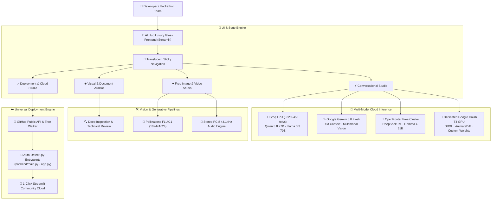

<div align="center">

# ⚡ AI HUB — Autonomous Multi-Model Prototyping Studio
### *Zero-GPU Hackathon Studio for Real-Time LLM Streaming, Multimodal Vision, Vector Art & Cloud Video Synthesis*

[](https://share.streamlit.io/)
[](https://python.org)
[](LICENSE)
[](https://github.com/ankush-dev-eng/ai-hub)
[](https://github.com/ankush-dev-eng/ai-hub)

<br/>

```
  █████╗ ██╗    ██╗  ██╗██╗   ██╗██████╗ 
 ██╔══██╗██║    ██║  ██║██║   ██║██╔══██╗
 ███████║██║    ███████║██║   ██║██████╔╝
 ██╔══██║██║    ██╔══██║██║   ██║██╔══██╗
 ██║  ██║██║    ██║  ██║╚██████╔╝██████╔╝
 ╚═╝  ╚═╝╚═╝    ╚═╝  ╚═╝ ╚═════╝ ╚═════╝ 
   Autonomous Multi-Model Prototyping Platform
```

<p align="center">
  <b>Instant Hot-Swappable LLMs</b> • 
  <b>Multimodal Document & Vision Auditing</b> • 
  <b>FLUX.1 High-Resolution Art</b> • 
  <b>Zero-Card Cloud Deployer</b>
</p>

</div>

---

## 🌌 Overview

**AI Hub** is a multi-model workspace engineered for hackathons, rapid prototyping, and production MVPs. It unifies the world's fastest and most capable free cloud AI engines into a unified translucent glass dashboard that runs at **0% local GPU load**.

### 🌟 Key Highlights
* **⚡ 450+ tok/s Instant Inference:** Powered by Groq LPU (Qwen 3.8 27B, Llama 3.3 70B, GPT-OSS).
* **👁️ Multimodal Visual Auditing:** Integrated Google Gemini 3.8 Flash Vision for OCR, code audits, architecture diagram critique, and multi-image context.
* **🎨 Cloud & Colab Media Studio:** 1024×1024 FLUX.1 generative art, vector anime logos, and procedural 44.1kHz stereo soundscapes.
* **🚀 Universal 1-Click Cloud Deployer:** Auto-discovers any public GitHub repository (e.g. `ankush-dev-eng/NiveshRakshak`), detects non-standard entrypoints (like `backend/main.py`), and pre-configures zero-error deployment links for Streamlit Community Cloud.
* **💎 Luxury Glass Aurora UI:** Translucent frosted panels, cursor-following atmospheric aurora lighting, and seamless collapsing sidebars.

---

## 🏛️ System Architecture



---

## ⚡ Supported Cloud Engines & Models

| Engine | Primary Models | Context Window | Speed | Cost |
| :--- | :--- | :--- | :--- | :--- |
| **⚡ Groq LPU** | `qwen/qwen3.8-27b`, `llama-3.3-70b-versatile`, `gpt-oss-120b` | 131K tokens | **~320 – 450 tok/s** | **100% Free** |
| **✨ Google Gemini** | `gemini-3.8-flash`, `gemini-2.5-flash-lite`, `gemini-3.1-flash-lite` | **1,000,000 tokens** | ~180 tok/s | **100% Free** |
| **🧠 OpenRouter** | `deepseek/deepseek-r1:free`, `google/gemma-4-31b-it:free` | 64K tokens | ~70 – 140 tok/s | **100% Free** |
| **🎨 Cloud FLUX** | Pollinations FLUX.1 Schnell | 1024×1024 px | ~2.5s render | **100% Free** |
| **🚀 Colab Bridge** | Google Colab Free 16GB T4 GPU (SDXL, Video, PyTorch) | Custom | Dedicated GPU | **100% Free** |

---

## 🚀 Quick Start Guide

### 1. Clone & Set Up Environment
```bash
# Clone the repository
git clone https://github.com/ankush-dev-eng/ai-hub.git
cd ai-hub

# Create and activate virtual environment
python -m venv .venv

# Windows
.venv\Scripts\activate

# macOS / Linux
source .venv/bin/activate

# Install dependencies with uv (or pip)
pip install -r requirements.txt
```

### 2. Configure Credentials (Zero Credit Card Required)
Create a `.env` file in the project root:
```env
# Free at https://aistudio.google.com/
GEMINI_API_KEY=your_gemini_api_key

# Free at https://console.groq.com/
GROQ_API_KEY=your_groq_api_key

# Free at https://openrouter.ai/
OPENROUTER_API_KEY=your_openrouter_api_key

# Free token at https://huggingface.co/settings/tokens
HF_TOKEN=your_huggingface_token
```

### 3. Launch the Studio
```bash
streamlit run app.py
```
Or double-click `Start_Hackathon_Hub.bat` on Windows.

---

## 🌐 Universal 1-Click Cloud Deployment

Deploying multiple hackathon projects often fails when Streamlit Cloud defaults to expecting `app.py` in the root folder, while projects like `NiveshRakshak` house their primary file in subdirectories (`backend/main.py`).

**AI Hub solves this automatically:**
1. Navigate to **↗ Deployment & Guide** in the studio navigation.
2. Select any repository from your GitHub roster (or click **🔄 Refresh Repos** to fetch your latest repositories live).
3. AI Hub queries the GitHub tree and automatically lists all real `.py` entrypoints.
4. Click **🚀 Deploy Live on Streamlit Cloud** to open the pre-configured deployment flow with zero missing-file errors!

---

## 🎨 Design System & Aesthetics

* **Base Canvas:** Deep Cyber Ink (`#07080d`) with translucent backdrop blur (`rgba(14, 18, 28, 0.45)`).
* **Typography:** `Space Grotesk` (display & hero branding), `Inter` (body copy), and `JetBrains Mono` (telemetry & code).
* **Atmospheric Lighting:** Cursor-following spotlight with tab-reactive color pairs:
  * **Tab 1 (Conversational Studio):** Electric Indigo (`#6366f1`) → Telemetry Cyan (`#22d3ee`)
  * **Tab 2 (Visual Auditor):** Deep Violet (`#a855f7`) → Neon Fuchsia (`#ec4899`)
  * **Tab 3 (Media Studio):** Neon Fuchsia (`#ec4899`) → Warm Amber (`#fbbf24`)
  * **Tab 4 (Cloud Deployment):** Emerald Mint (`#34d399`) → Telemetry Cyan (`#22d3ee`)

---

## 🛡️ Privacy & Security
* All API keys are loaded locally from `.env` and excluded from git tracking.
* In public mode (`STUDIO_PUBLIC_MODE = "1"`), API keys and session states are sandboxed to protect creator credentials.
* Zero telemetry is transmitted to third-party tracking services.

---

<div align="center">

Crafted with ⚡ for high-velocity hackathons and rapid AI builders.  
**© 2026 Ankush & AI Hub Contributors.** Distributed under the MIT License.

</div>
